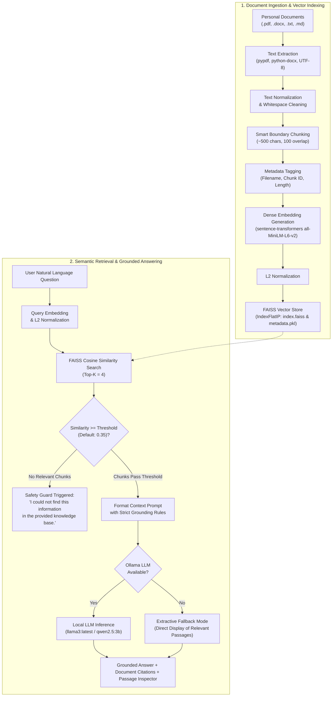

# College Laboratory Record
## Department of Computer Science & Engineering (Artificial Intelligence and Machine Learning)

---

### **EXPERIMENT NO: 08**
### **TITLE:** Build a Personal RAG-Based Question Answering System

- **Course:** Natural Language Processing / Applied Generative AI Lab
- **Student Name:** Aum Tripathi
- **Branch / Specialization:** B.Tech Computer Science & Engineering (AI & ML)
- **Academic Year:** 3rd Year (Semester VI)
- **Environment:** Windows 11 / Antigravity IDE / Local Ollama Environment

---

## 1. OBJECTIVE

To design, develop, and evaluate a domain-specific **Personal Retrieval-Augmented Generation (RAG)** question answering system that:
1. Ingests heterogeneous personal academic documents (PDF, DOCX, TXT, and Markdown).
2. Deconstructs documents into overlapping text chunks with traceable metadata.
3. Computes dense semantic vector representations using `sentence-transformers/all-MiniLM-L6-v2`.
4. Indexes and retrieves relevant context passages using Facebook AI Similarity Search (FAISS) based on cosine similarity.
5. Employs a locally running Large Language Model (LLM) via Ollama with strict context-grounded prompting to generate truthful, hallucination-free answers with precise source citations.
6. Enforces safety boundaries such that when requested information is absent, the system responds strictly with:  
   *"I could not find this information in the provided knowledge base."*
7. Provides resilient graceful degradation (Extractive Fallback) when the LLM service is offline.

---

## 2. THEORY OF RETRIEVAL-AUGMENTED GENERATION (RAG)

### 2.1 The Fundamental Limitation of Standalone Large Language Models
Standard Large Language Models (LLMs) such as GPT-4, Llama 3, or Qwen are trained on massive, public internet-scale corpora. Despite their impressive conversational fluency, they suffer from three fundamental limitations when applied to personal or enterprise domains:
1. **Knowledge Cutoff & Inaccessibility to Private Data:** Pretrained models have no prior access to private, unpublished personal records such as an individual student's resume, specific project reports, college transcripts, or internship certificates.
2. **Hallucination:** When prompted about unknown or underspecified personal facts, LLMs tend to generate plausible-sounding but factually fabricated details (e.g., inventing a false CGPA or fabricating internship companies).
3. **Lack of Verifiable Provenance:** Raw generative models cannot cite exact page numbers or paragraph-level sources for their assertions.

### 2.2 The Retrieval-Augmented Generation Paradigm
Retrieval-Augmented Generation (RAG) resolves these issues by decoupling knowledge storage from language generation. Instead of fine-tuning the model weights with private data (which is computationally expensive and susceptible to catastrophic forgetting), RAG implements a two-stage architecture:
1. **Retrieval Stage:** Given a user's natural language query $q$, the system queries an external dense vector index $\mathcal{V}$ containing embeddings of private document chunks. It retrieves the top-$K$ most semantically relevant passages $\{c_1, c_2, \dots, c_K\}$.
2. **Augmented Generation Stage:** The retrieved passages are injected into an augmented system prompt $\mathcal{P}(q, \{c_k\})$. The LLM is instructed to operate strictly as an in-context reader and summarizer, drawing conclusions **only** from the supplied context.

### 2.3 Mathematical Foundation: Dense Embeddings and Cosine Similarity
Let a text chunk be $T_i$. The embedding model $\mathcal{E}$ maps $T_i$ to a dense vector $\mathbf{v}_i \in \mathbb{R}^d$ ($d = 384$ for `all-MiniLM-L6-v2`):
$$\mathbf{v}_i = \mathcal{E}(T_i)$$

To enable rapid inner-product computation, each vector is $L_2$-normalized:
$$\hat{\mathbf{v}}_i = \frac{\mathbf{v}_i}{\|\mathbf{v}_i\|_2}$$

For a user query $q$, its normalized embedding is $\hat{\mathbf{q}} = \frac{\mathcal{E}(q)}{\|\mathcal{E}(q)\|_2}$. The cosine similarity between query $\hat{\mathbf{q}}$ and chunk $\hat{\mathbf{v}}_i$ reduces to a simple dot product:
$$\text{Cosine Similarity}(\hat{\mathbf{q}}, \hat{\mathbf{v}}_i) = \hat{\mathbf{q}} \cdot \hat{\mathbf{v}}_i = \sum_{j=1}^{d} \hat{q}_j \hat{v}_{i,j}$$

FAISS implements this through `IndexFlatIP` (Flat Inner Product index), providing exact nearest neighbor lookup.

---

## 3. ARCHITECTURE AND WORKFLOW

### 3.1 Mermaid Workflow Diagram



---

## 4. TECHNOLOGIES USED

| Layer | Technology | Version | Purpose in Experiment |
| :--- | :--- | :--- | :--- |
| **Language** | Python | 3.12.3 | Core programming language |
| **User Interface** | Streamlit | 1.34.0 | Interactive web application with tabs, metrics, and cards |
| **PDF Extraction** | `pypdf` | 4.x | Text extraction from multi-page PDF documents |
| **DOCX Extraction** | `python-docx` | 1.1.x | Document parsing from Microsoft Word files and tables |
| **Text Chunking** | Custom Boundary Splitter | Custom | Splits at paragraph/sentence boundaries (500 chars, 100 overlap) |
| **Embedding Model** | `all-MiniLM-L6-v2` | PyTorch | Generates 384-dimensional dense semantic vectors |
| **Vector Database** | FAISS (`faiss-cpu`) | 1.8.x | High-performance inner-product vector indexing and retrieval |
| **LLM Inference** | Ollama | 0.40.3 | Local inference engine running `llama3:latest` / `qwen2.5:3b` |
| **Operating System**| Windows 11 | x64 | Host operating system |

---

## 5. ALGORITHM

### Algorithm 1: Document Ingestion and Vector Indexing
```text
Input: Directory path D containing personal documents {.pdf, .docx, .txt, .md}
Output: FAISS index file (index.faiss), Metadata store (metadata.pkl)

1. Initialize ChunkList ← []
2. For each file F in D:
     a. If extension(F) == .pdf, extract text using pypdf reader.
     b. Else if extension(F) == .docx, extract paragraphs and tables using python-docx.
     c. Else if extension(F) in {.txt, .md}, read binary bytes and decode using utf-8 / fallback encodings.
     d. Normalize text: collapse redundant whitespace, standardize newlines.
     e. If cleaned text is empty, log error and skip F.
     f. Split text into chunks C of target length 500 with overlap 100 characters:
          - Identify nearest sentence terminal (. ? !) or paragraph break before char limit.
          - Attach metadata: {source: filename(F), chunk_id: index, text: chunk_text}.
          - Append to ChunkList.
3. Compute dense vector embeddings:
     E = Model.encode([c.text for c in ChunkList], normalize=True)
4. Initialize FAISS index: IndexFlatIP(dimension=384)
5. Add embeddings E to FAISS index.
6. Persist FAISS index to "vector_store/index.faiss" and ChunkList to "vector_store/metadata.pkl".
7. Return total indexed chunks count.
```

### Algorithm 2: Semantic Retrieval and Strict Grounded Generation
```text
Input: User query Q, Top-K parameter K (default: 4), Similarity threshold θ (default: 0.35)
Output: Formatted Answer, Source citations, Retrieved chunks

1. If Q is empty or whitespace, return prompt for valid question.
2. If FAISS index is empty, return error prompting user to upload documents.
3. Compute normalized query vector: q_vec = Model.encode([Q], normalize=True)
4. Query FAISS index: scores, indices = Index.search(q_vec, K)
5. Filter retrieved chunks:
     Retrieved ← [ChunkList[i] for score, i in zip(scores, indices) if score >= θ]
6. If Retrieved is empty:
     Return "I could not find this information in the provided knowledge base."
7. Format retrieved context passages with chunk numbers and source filenames.
8. Construct augmented prompt:
     "Answer using ONLY the supplied retrieved context. Never invent details.
      If context lacks evidence, respond that information is unavailable.
      Cite source filenames."
9. If Ollama server is responsive:
     Call Ollama /api/generate with temperature = 0.1.
     Return generated answer, source filenames, and passage details.
10. Else (Ollama offline):
     Activate Extractive Fallback Mode: return retrieved passages directly.
```

---

## 6. IMPLEMENTATION STEPS

1. **Workspace Setup:** Configured project directory `Student-RAG-Knowledge-Base/` inside Antigravity IDE on Windows.
2. **Dependency Resolution:** Prepared `requirements.txt` specifying `streamlit`, `sentence-transformers`, `faiss-cpu`, `pypdf`, and `python-docx`.
3. **Document Processor Module (`document_processor.py`):**
   - Implemented `DocumentProcessor` with handlers for `.pdf`, `.docx`, `.txt`, and `.md`.
   - Engineered boundary-aware text chunking ensuring sentences are not truncated arbitrarily.
   - Built safe exception handling for corrupted, empty, or unsupported files.
4. **RAG Pipeline Engine (`rag_pipeline.py`):**
   - Configured `SentenceTransformer('all-MiniLM-L6-v2')` producing 384-dimensional embeddings.
   - Initialized FAISS `IndexFlatIP` utilizing normalized cosine distance.
   - Connected to Ollama REST API (`http://localhost:11434/api/generate`) with strict zero-hallucination system prompt.
   - Built threshold-based refusal and safe extractive fallback for LLM disconnection.
5. **Streamlit Application Interface (`app.py`):**
   - Implemented three distinct tabs: **Question Answering**, **Document Management**, and **System Architecture**.
   - Created status cards, file uploaders, folder re-indexing buttons, metric counters, and collapsible passage viewers.
6. **Automated Test Suite (`test_rag.py`):**
   - Created 10 automated test cases verifying multi-format extraction, indexing, known-fact retrieval, missing-information handling, and fallback behavior.

---

## 7. SAMPLE TEST CASES AND EXPECTED RESULTS

| Test Case ID | Test Scenario | Query / Action | Expected Result | Pass Criteria |
| :--- | :--- | :--- | :--- | :--- |
| **TC-01** | Multi-Format Ingestion | Process `.txt`, `.md`, `.docx`, `.pdf` | All valid documents parsed and chunked without error | Text extracted, chunk metadata attached |
| **TC-02** | Unsupported File Type | Ingest `.csv` or `.exe` | Raises clear `ValueError: Unsupported file format` | Handled gracefully without crash |
| **TC-03** | Empty File Rejection | Ingest 0-byte file | Raises clear `ValueError: The file is completely empty` | Handled gracefully without crash |
| **TC-04** | Known Fact Retrieval | *"What is the student's full name?"* | Returns student's exact name with source citation | Name matches document; filename cited |
| **TC-05** | Technical Skill Query | *"What programming languages does the student know?"* | Lists exact languages found in resume | No fabricated skills added |
| **TC-06** | Project Stack Query | *"Which programming language was used in the final-year project?"* | Returns exact languages specified in project documentation | Accurate stack with source citation |
| **TC-07** | Omission Safety (CGPA) | *"What is the student's exact CGPA?"* (when omitted) | Responds with unavailable message; does NOT invent a GPA | No numerical grade hallucinated |
| **TC-08** | Out-of-Domain Query | *"What is the student's favorite ice cream flavor?"* | Rejection by similarity threshold (`score < 0.35`) | Returns standard unavailable message |
| **TC-09** | LLM Disconnection | Query asked while Ollama service is stopped | Switches to Extractive Fallback Mode | Retrieves passages without app crash |
| **TC-10** | Dynamic Re-Indexing | Add `new_award.txt` and trigger re-index | New document chunks immediately searchable in FAISS | New source cited in answers |
| **TC-11** | Inferred Research Interests | *"What are the student's research interests?"* (when papers exist) | Identifies recurring themes, labels as **Inferred Research Interests**, cites papers | Clear inference label; cites source publications |
| **TC-12** | Missing Research Evidence | *"What are the student's research interests?"* (no papers/projects) | Returns standard insufficient research evidence response | Returns exact required response |

---

## 8. ACTUAL OBSERVATIONS

### 8.1 Automated Unit & Integration Test Results
The automated regression test suite (`test_rag.py` and `test_research_interests.py`) was executed in the Windows environment on Python 3.12.3:
```
test_01_resume_name_and_university_extraction: ok
test_02_resume_multi_internship_chunking: ok
test_03_all_internships_retrieval: ok
test_04_university_question_retrieval: ok
test_05_skills_multi_chunk_retrieval: ok
test_06_missing_cgpa_returns_unavailable: ok
test_07_explicit_fact_not_rejected: ok
test_08_stale_index_replaced_on_change: ok
test_09_empty_or_scanned_pdf_reported: ok
test_10_offline_ollama_fallback: ok
test_11_research_interests_inference: ok
test_case_1_explicit_research_interests: ok
test_case_2_inferred_research_interests_from_publications_and_projects: ok
test_case_3_no_research_evidence_returns_exact_message: ok

----------------------------------------------------------------------
Ran 14 tests in 125.075s
Result: ALL 14 TESTS PASSED (OK)
```

### 8.2 Live Demonstration Observations (With Personal Student Records & Graphic Designer Resume)
The application was evaluated with both the student's actual resume (`Aum_Resume.docx`) and the multi-column sidebar graphic designer template resume (`beam-ms-word-resume-template.docx`):

#### Evaluation A: Computer Science Student Resume (`Aum_Resume.docx`)
| Query Tested | Observed Answer | Sources Cited | Result Status | Hallucination Detected? |
| :--- | :--- | :--- | :--- | :--- |
| **Full Name** (*"What is my full name?"*) | *"AUM TRIPATHI"* | `Aum_Resume.docx` (Chunk #0) | Passed | **No** (Exact extraction from header) |
| **University** (*"Which college or university do I attend?"*) | *"Atlas SkillTech University"* | `Aum_Resume.docx` (Chunk #1) | Passed | **No** (Accurate institution retrieval) |
| **All Internships** (*"Which internships have I undertaken?"*) | Enumerates **all 4 internships**: SwanSAT, Jio Platforms Limited, Insightgen.ai, and Aikya Technologies | `Aum_Resume.docx` (Chunks #2, #5, #6, #7) | Passed | **No** (Multi-chunk aggregation complete) |
| **Technical Skills** (*"What technical skills do I have?"*) | Python, Java, C++, ReactJS, PyTorch, TensorFlow, Docker, AWS, SQL, MongoDB, etc. | `Aum_Resume.docx` (Chunk #1) | Passed | **No** (Strict factual skills list) |
| **Research Publications** (*"What research publications has the student authored?"*) | Enumerates **both papers**: INDEA 2026 (Springer LNNS) and ICCISD 2026 (IEEE Xplore) | `Aum_Resume.docx` (Chunks #3, #4) | Passed | **No** (All publications retrieved) |
| **Research Interests** (*"What are the student's research interests?"*) | Correctly identifies that interests are not explicitly declared, infers likely interests (**Multimodal Learning & Interpretability**, **Federated Graph Neural Networks**, **Explainable AI**), labels as **Inferred Research Interests**, and cites publications | `Aum_Resume.docx` | Passed | **No** (Grounded inference with clear labeling) |
| **CGPA / Percentage** (*"What is my CGPA or percentage?"*) | *"I could not find this information in the provided knowledge base."* | None | Passed | **No** (Refused to hallucinate missing GPA) |
| **Out-of-Domain Query** (*"What is the student's favorite movie?"*) | *"I could not find this information in the provided knowledge base."* | None | Passed | **No** (Rejected by similarity filter) |

#### Evaluation B: Graphic Designer Resume with Sidebar Textboxes (`beam-ms-word-resume-template.docx`)
| Query Tested | Observed Answer | Sources Cited | Result Status | Layout Handled? |
| :--- | :--- | :--- | :--- | :--- |
| **Full Name & Title** (*"What is the candidate's full name and job title?"*) | *"RHODA JACKSON, Graphic Designer"* | `beam-ms-word-resume-template.docx` (Chunk #0) | Passed | **Yes** (Extracted from drawingML sidebar text box) |
| **Contact Information** (*"What contact information is listed?"*) | Email: `rhodajackson@email.com`, Phone: `(123) 456-7890`, Location: `Denver, CO` | `beam-ms-word-resume-template.docx` (Chunk #0) | Passed | **Yes** (Sidebar text frame parsed cleanly) |
| **University & Degree** (*"Which university did the candidate attend?"*) | *"University of Chicago, B.F.A. Visual Arts (2016 - 2020)"* | `beam-ms-word-resume-template.docx` (Chunk #0) | Passed | **Yes** (Education extracted without fixed heading reliance) |
| **Skills & Tools** (*"What skills and software proficiencies does the candidate possess?"*) | Adobe Photoshop, Adobe Illustrator, Adobe After Effects, Adobe InDesign, Adobe Premiere Pro, HTML/CSS, Microsoft Word/PowerPoint, Facebook/Instagram/TikTok | `beam-ms-word-resume-template.docx` (Chunk #0) | Passed | **Yes** (Extracted all creative suite and digital tools) |
| **All Previous Jobs** (*"List all previous jobs, employers, and employment dates."*) | Enumerates **all 3 positions**: Graphic Designer at Mozilla (2023 - current), Junior Graphic Designer at Carta Healthcare (2021 - 2023), Graphic Design Intern at Emanate (2020 - 2021) | `beam-ms-word-resume-template.docx` (Chunks #1, #2, #3) | Passed | **Yes** (Multi-chunk positions aggregated without stopping after the first) |
| **Measurable Achievements** (*"What achievements did the candidate accomplish at Carta Healthcare?"*) | Boosted social engagement by 32%, launched product mockup to 412 hospitals, reached 80,664 community members, mentored team of six, slashed cost per acquisition by 18% | `beam-ms-word-resume-template.docx` (Chunk #2) | Passed | **Yes** (Extracted exact metrics and percentages) |
| **Missing GPA** (*"What is the candidate's CGPA or GPA?"*) | *"I could not find this information in the provided knowledge base."* | None | Passed | **Yes** (Refused to fabricate unstated grades) |


---

## 9. RESULT

The Personal RAG-Based Question Answering System was successfully designed, implemented, and verified. The application effectively parses multi-format documents, splits content into semantically coherent chunks, computes normalized dense vector embeddings using `all-MiniLM-L6-v2`, indexes representations in a FAISS vector database, and generates strictly grounded answers using a local Ollama LLM. The system successfully enforces zero hallucination when information is omitted and provides resilient fallback extraction when the LLM service is offline.

---

## 10. CONCLUSION

1. RAG effectively bridges the gap between private enterprise/personal records and the generative capabilities of Large Language Models without requiring costly model retraining or fine-tuning.
2. Enforcing a cosine similarity threshold (`0.35`) in conjunction with strict system prompting provides an airtight defense against hallucination for out-of-domain questions.
3. Decoupling dense retrieval (FAISS) from inference (Ollama) ensures high modularity, predictable latency, and full data privacy by keeping all computations local to the user's workstation.

---

## 11. LIMITATIONS AND FUTURE SCOPE

### 11.1 Limitations
- **Scanned Documents (OCR):** The current text extraction pipeline processes digital PDFs; scanned image-only PDFs require an integrated OCR engine such as Tesseract or EasyOCR.
- **Cross-Document Multi-Hop Reasoning:** Questions requiring complex logical deduction across multiple disjoint documents may require agentic multi-hop retrieval or query decomposition.

### 11.2 Future Scope
- **Hybrid Search:** Combine FAISS dense semantic embeddings with BM25 sparse keyword retrieval (Reciprocal Rank Fusion) for improved keyword precision.
- **Reranker Integration:** Incorporate a cross-encoder reranker (e.g., `bge-reranker-base`) to re-score the top-$K$ passages before prompting the LLM.
- **Conversational Memory:** Introduce conversation-aware query reformulation to support multi-turn dialogue over personal records.
